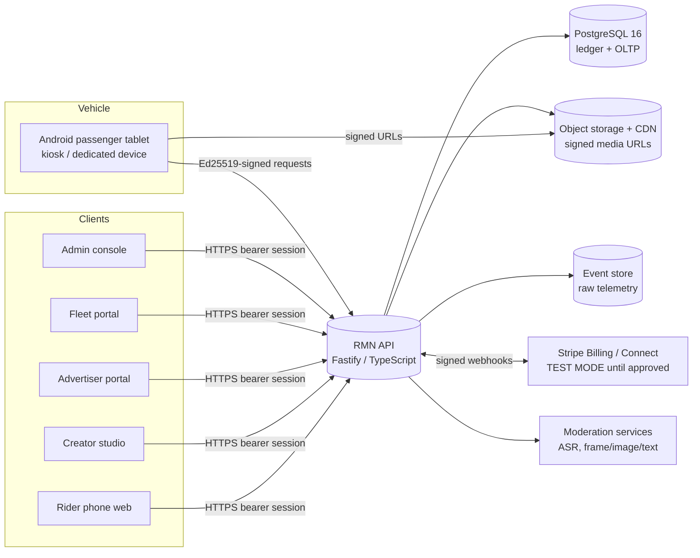

# Architecture

## System context

Implemented now: the API, PostgreSQL schema, finance-core, admin shell and device protocol. Everything else in the diagram is planned (see `BACKLOG.md`).

## Modules (bounded contexts)
Each module owns its tables and exposes routes. Cross-module access goes through service functions, never direct writes to another module's tables. Third-party modules (Phase 6) get scoped API clients and **never** direct ledger or PII access.

| Module | Code | Status |
|---|---|---|
| identity / tenancy / RBAC | `src/auth`, `modules/identity`, `modules/orgs` | implemented |
| devices / fleets | `modules/fleets`, `modules/devices` | implemented |
| ledger | `modules/ledger` | implemented |
| revenue rules / allocations | `modules/revenue` + `packages/finance-core` | implemented (calculation + posting) |
| media, moderation, campaigns, schedules, targeting, analytics, subscriptions, attribution, payouts, coupons, rewards, games, notifications, integrations | — | planned, Phases 2–6 |

## Architecture decision records

**ADR-1 Modular monolith first.** A single deployable API with strict module boundaries and one PostgreSQL database. Financial consistency needs ACID transactions across allocation and ledger; microservices would add distributed-transaction risk with no benefit at launch. Modules can later be extracted behind the same contracts.

**ADR-2 PostgreSQL enforces financial invariants.** Balance, immutability, periods, uniqueness and overlap are DB constraints and triggers, so a bug or a script cannot violate them. Application validation exists for good error messages. (R-002: the app must not run as the table owner.)

**ADR-3 Pure finance core.** `@rmn/finance-core` has no I/O: deterministic, exhaustively property-tested, reusable by the API, batch jobs and statement generation. All calculation inputs and outputs are stored in `allocation_batches.calculation` for audit replay.

**ADR-4 Opaque sessions + TOTP MFA.** Revocable server-side sessions; MFA mandatory for every permission flagged `requires_mfa` (finance, platform administration, support). Impersonation sessions can never use those permissions.

**ADR-5 Device identity by keypair.** Tablets generate an Ed25519 keypair (Android Keystore, non-exportable) at enrollment and sign every request (method, path, timestamp, nonce, body hash). The server stores only the public key. One-time enrollment codes come from a fleet admin. Replay is blocked by a nonce table and clock-skew window.

**ADR-6 Raw vs. validated events (Phase 2).** Device telemetry lands in an append-only raw store. A validation stage (signature, dedupe by event ID, drift handling, eligibility, fraud heuristics) produces *validated billable events*. Only validated aggregates can feed an allocation batch. Offline events are accepted but never automatically billable (spec invariant 12).

**ADR-7 Payments isolated behind a provider adapter.** Stripe is used in test mode only. Live mode needs D-010, D-026 and an integration verification run. Webhooks enter a signed, idempotent inbox; ledger postings use `stripe:<event_id>` idempotency keys.

**ADR-8 Fail closed.** Missing rule → refuse. AI moderation uncertain or erroring → HOLD for human review. Unknown device → reject. Ineligible recipient → never paid.

## Deployment shape
- Stateless API containers behind a TLS-terminating load balancer.
- Managed PostgreSQL with PITR backups, encryption at rest, and a separate migration (owner) role vs. runtime role.
- Object storage + CDN with signed URLs for media.
- Secrets from a secret manager.

See `DEPLOYMENT.md`.
