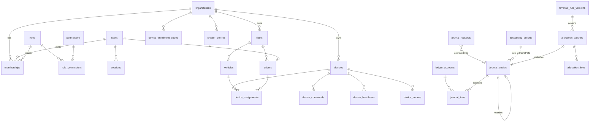

# Entity-Relationship Design

## Implemented (migrations 0001–0004)

### Key constraints
- **Tenant scoping:** `fleets`, `vehicles`, `drivers`, `devices` and `device_assignments` use composite `(id, org_id)` keys and composite FKs, so a row can never reference another tenant's row.
- `memberships`: the role's `org_kind` must match the organization's kind (trigger).
- `device_assignments`: GiST exclusion prevents overlapping assignments per device **and** per vehicle.
- `journal_lines`: exactly one of debit/credit > 0; party columns both present or both null.
- `journal_entries.reverses_entry_id UNIQUE`; `source_type = 'REVERSAL'` ⇔ `reverses_entry_id` present.
- `accounting_periods`: non-overlapping date ranges (GiST exclusion).
- `revenue_rule_versions`: bps sum to 10000; no creator share on no-creator categories; approver1 ≠ approver2 ≠ drafter; non-draft versions cannot overlap per category (GiST exclusion).
- `allocation_batches`: `net = gross − tax − refunds − credits − chargebacks − deductions`; POSTED ⇔ journal entry present.

### Retention (proposed defaults; DECISION REQUIRED with counsel)
| Data | Retention |
|---|---|
| Ledger, allocations, rules, audit log | ≥ 7 years, immutable |
| `device_nonces` | 1 day (purge job, Phase 1 remainder) |
| `device_heartbeats` | 90 days raw, then daily aggregates |
| Sessions | 90 days after expiry |
| Rider session data on tablet | purged at session end |
| Precise location | not stored server-side by default (Phase 5) |

## Planned entities by phase
- **Phase 2:** channels, videos, video_versions, licenses/attestations, moderation_cases, moderation_decisions, playlists, playlist_items, advertisers (profile on org), campaigns, creatives, schedules, geo_targets, budgets, raw_events (event store), validated_events, analytics_aggregates.
- **Phase 3:** subscriptions, invoices, payments, refunds, chargebacks, webhook_inbox, webhook_outbox, reconciliation_runs, reconciliation_exceptions, tax_records.
- **Phase 4:** commission_agreements, click_events, conversions, commission_events, attribution_decisions, payout_accounts (provider refs only, no bank data), payout_batches, payout_records, disputes.
- **Phase 5:** rider_accounts, rider_sessions, qr_login_tokens, coupons, coupon_claims, redemptions, geofences, geofence_triggers, games, game_sessions, rewards, reward_liabilities.
- **Phase 6:** integration_clients (scoped keys/OAuth), module_registry, white-label themes.
